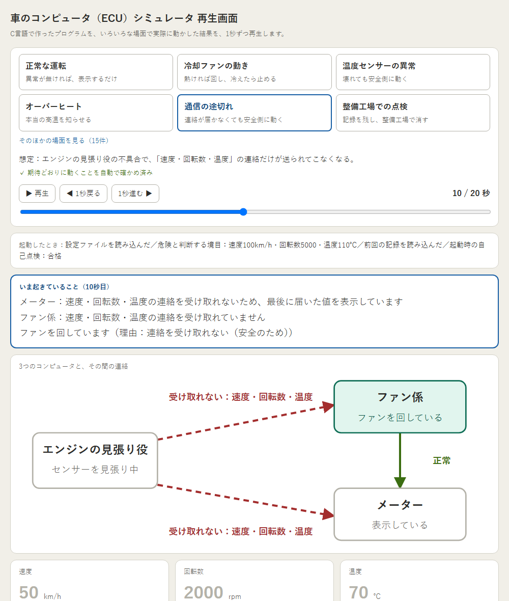
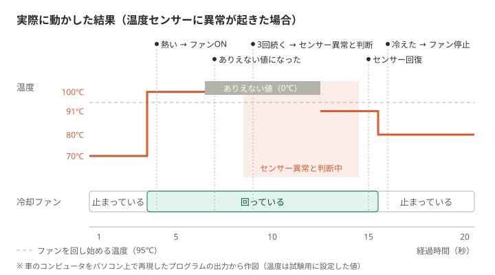

# automotive-ecu-learning

車載ソフトウェア開発への理解を深めるため、C言語、状態管理、診断、通信の基礎を段階的に学ぶ個人開発プロジェクト。

[](https://github.com/tanaka780/automotive-ecu-learning/actions/workflows/ci.yml)

---

## このプログラムについて

車の中にある3つのコンピュータ（エンジンの見張り役・ファン係・メーター）の動きを、
C言語でパソコン上に再現したプログラム。エンジンの見張り役は温度などを1秒ごとに確かめ、異常を見つけると記録する。
ファン係は熱ければ冷却ファンを回し、メーターは運転席に表示する。3つは車の中の通信線（CAN）でやり取りし、
異常があっても安全側に動き続ける。



実際に動かした結果を1秒ずつ再生する画面。再生画面で見られる21の場面のうち「通信の途切れ」を再生している途中（10秒目）で、
エンジンの見張り役からの連絡が、ファン係とメーターに届かなくなっている。
ファン係は本当の温度が分からないので安全のためファンを回し、メーターは最後に届いた値を表示している。

**再生画面をブラウザで見る（インストールは要らない）**：[https://tanaka780.github.io/automotive-ecu-learning/viewer/](https://tanaka780.github.io/automotive-ecu-learning/viewer/)

### 実際に動かした結果の例：温度センサーの異常（20秒間の流れ）

21の場面のうち「温度センサーの異常」の20秒間を、1枚の図にしたもの。温度が上がるとファンを回す。
途中で温度センサーの配線が切れて、ありえない値になると、直前の正しい温度を使い、3回続いたらセンサーの異常と判断する。
本当の温度が分からないので、安全のためファンを回し続ける。センサーが元に戻り、温度が下がってからファンを止める。
ほかの対応は、下の「できること」の表と再生画面で見られる。



### できること

| 分類 | 場面 | プログラムの動き |
| --- | --- | --- |
| 普段 | 異常が無い | 1秒ごとに速度・回転数・温度を確かめてメーターに表示するだけで、警告も記録もしない |
| センサー | 速度・回転数・温度のどれかが危険な値 | 警告を出し、危険になった瞬間を記録する（そのときの車の状態も1回だけ保存） |
| | 速度・回転数の危険な値が3回続く | そのセンサーは異常と判断し、安全な値（停車・アイドリング相当）に置き換えて動き続ける |
| | 温度センサーが、ありえない値（配線が切れた・つながった）を出す | 記録し、直前の正しい温度を使う。3回続いたらセンサーの異常と判断して常温相当に置き換え、メーターは温度を「--」と表示する |
| | 温度が危険な高さ（オーバーヒート） | 本当の温度なので置き換えず、警告し、メーターに高温の警告を出す。オーバーヒートの途中でセンサーが壊れても、高温の警告は残す |
| | 正常な値が3回続く | 回復と判断して、元の値に戻す（温度は、ありうる値なら高温のままでも回復と判断する） |
| | 複数のセンサーが同時に異常 | それぞれ別々に判断・記録する |
| 冷却ファン | 温度の上下 | 熱ければ回し、冷えたら止める。境目の温度で細かくON/OFFを繰り返さない |
| | 温度センサーの異常 | 本当の温度が分からないので、安全のため回し続ける（直った直後も、新しい温度で判断できるまで止めない） |
| | ファン係の中の処理が止まる | 温度を受け取る処理や、回すかを決める処理が止まっても、決まった時間（1〜4秒）を過ぎたら、安全のため回す。処理が動き出すと、いつもの判断に戻る |
| コンピュータ間の通信 | 連絡が3回続けて届かない | 途切れと判断して記録する。メーターは最後の値を「途切れ」と示して表示し（警告灯の連絡が途切れたときは、温度が本当の値か分からないので「--」と表示する）、ファンは安全側（回す）に倒す |
| | 速度・回転数・温度の連絡に、ありえない値が入っている | 途切れと同じく異常として扱い、記録する |
| | 3回続けて届くようになる | 回復と判断する |
| | ファン係からの連絡が途切れる | メーターが「ファン係の異常」として記録する |
| 起動・終了 | 起動するとき | 設定と、エンジンの見張り役の記録を読めたかを自己点検する |
| | 設定ファイルが無い・壊れている | 決めてある値で動き続ける |
| | 記録ファイルが無い・壊れている | 記録ゼロから始める |
| | 終了するとき | 故障と通信の途切れの記録を保存し（保存に失敗したことも検出）、次の起動で引き継ぐ |
| | エンジンを切っている間 | 何もしない。かけ直すと、3つのコンピュータとも判断をやり直す（記録は残す） |
| 点検 | 整備工場での点検 | エンジンを切っているときだけ、点検用のコマンドで記録を全部、またはセンサーごとに消せる。おかしな命令は受け付けない |
| | 診断機（スキャンツール）を通信線につなぐ | エンジンの見張り役が、実際の車と同じ決まり（UDS）で、記録が何件あるかを答え、記録を全部消す。対応していない命令には断る理由を返す。エンジンを切っている間は答えない |

上の表の対応は、冒頭の再生画面の21の場面で、1秒ずつ再生して見られる（リポジトリの[viewer/index.html](viewer/index.html)を、GitHub Pagesで公開したもの。ダウンロードしてこのファイルを開いても動く）。

### 技術的な要点（車載の考え方との対応）

| 作ったもの | 車載の考え方 | 主なファイル |
| --- | --- | --- |
| 3つのECUを、CANのメッセージ（ID 0x100・0x200・0x300、周期200ms・1000ms）だけでつなぐ。3回続けて届かなければ途絶、3回続けて届けば回復と確定する | ECU間通信と、通信の途絶の検出 | `src/common/can.c`・`debounce.c` |
| センサーの異常を3回の継続で確定し、安全な値に置き換えて動き続ける。ありえない値（断線・ショート）と、本当の高温（オーバーヒート）を分ける | フェイルセーフ（リンプホーム）、デバウンス | `src/engine_ecu/faultmgr.c`・`status.c` |
| 異常を記録の種類ごとに数え、状態（今も異常・過去に異常）と、最初の異常の瞬間の値（フリーズフレーム）を残す。終了時に保存し、次の起動で引き継ぐ | DTC（AUTOSARのDemに当たる役割）、不揮発メモリへの保存 | `src/engine_ecu/diag.c`・`src/common/dtc_status.c`・`src/persist.c` |
| 診断機の要求に、ISO 14229の決まりで答える（記録の件数の読み出し0x19 01・全消去0x14、対応しない要求への否定応答） | UDS（AUTOSARのDcmに当たる役割） | `src/engine_ecu/uds.c` |
| ファン係の処理が止まったことを、使う側が自分の時計で見つけ、ファンを安全側に回す | 処理の監視（AUTOSARのWdgMに当たる部分。リセットするWdgは作っていない） | `src/fan_ecu/fan_ecu.c` |
| 周期の仕事を登録し、決まった周期で順に動かす | 周期タスクの実行（OSの代わり） | `src/common/scheduler.c` |
| ECUごとのフォルダ・共通部品・いちばん下のドライバに分け、依存の向きを`make`のたびに確かめる | 層の分け方（AUTOSARのSWC・BSW・MCALの考え方） | `tools/check_deps.sh` |
| センサーの値・通信の途絶・処理の停止を設定ファイルで起こし、時計を差し替えて、20秒の動作を数ミリ秒で毎回同じ結果で動かす | 故障注入、シミュレーション上の時間での検証 | `sim/` |
| MISRA Cのルールの一部を、cppcheckで確かめて適用した | MISRA C | Phase14（下の学習フェーズ） |
| pushのたびに、ビルド（警告0件）・単体テスト・シナリオ検証を自動で動かす | CI | `.github/workflows/ci.yml` |

### 取り組みの量（2026年11月時点）

- 期間：2026年6月〜（約5か月）。作業の記録（日報）79日分
- 32の段階に分けて、小さく作っては確かめる、を繰り返した
- C言語のプログラム約4,300行、テストのプログラム約5,800行
- 10のシナリオ（車の使われ方の筋書き）を決め、上の表の対応を、自動テストと実際の実行で確かめている
- 自動テスト328件（部品ごとのテスト222件、全体を通して動かすテスト106件）

### 工夫したこと

- **わざと故障を起こして確かめる仕組み**：センサーの値を固定する・途中で変える、通信を途中で止める、
  エンジンを途中で切る・かけ直す、ファン係の処理を途中で止める、などを設定ファイルで起こせるようにし、故障したときの動きを毎回同じ条件で確かめられるようにした
- **時間を自由に進めるテストの仕組み**：20秒かかる動作確認を数ミリ秒で、毎回まったく同じ結果で
  動かせるようにした。これにより、普段のテストでは見つからなかった
  「タイミングによって冷却ファンが止まってしまう不具合」を2つ見つけて直した
- **処理が止まっても安全側に倒す見張り**：ファン係の中の処理が止まると、ファンのON/OFFが固まり、ほかのコンピュータからは
  異常に見えない。まず試験台で処理を止めて、熱くなってもファンが回らないことを再現してから、使う側が自分の時計で
  古さを確かめて安全のためファンを回す仕組みを足した
- **確かめる仕組みも、失敗するときに失敗するかを確かめる**：pushのたびにGitHub Actionsでテストを自動で動かす。
  実行の記録を確かめたところ、最初の設定ではテストが失敗しても成功と表示される作りだったことが分かったので、
  わざとテストを失敗させて見逃すことを確かめてから直し、直した後は失敗が伝わることも確かめた
- **AIは補助として使い、判断と説明は自分で行う**：方針は [docs/AI_workflow.md](docs/AI_workflow.md) に記載

詳しい仕組み・実行方法・学習の記録は、以下の各節と docs/ フォルダを参照。

---

## 概要

C言語未経験から始め、車載ECUで使われる考え方を小規模な実装で段階的に学ぶ。
実車ECUの再現が目的ではなく、「何をしたいコードか」「なぜその構成にしたか」を
自分で説明できる状態にすることを目指す。

---

## 学習目的

- C言語の基礎を理解する
- データの流れを追える設計を身につける
- 車載ソフトウェアで使われる考え方を小さく段階的に理解する
- 学習過程をGitHubに記録し、第三者に説明できる状態にする

---

## プロジェクトの方向性

リポジトリ名（automotive-ecu-learning）が示す通り、当初からC言語で自動車関連プログラムを作ることを目的としていた。Phase1〜9では、その足がかりとして、センサ・DTC・ログ・永続化・設定ファイル等、自動車関連プログラムで使われる個々の簡単な機能を1つずつ作りながら学んできた。これらが揃ってきた現在は、それらを統合し、「車両状態を模擬し、異常を検出・診断・記録し、電源再投入後も診断情報を保持できるECUソフトウェアシミュレータ」として完成させる方向へ焦点を移している。

Phase10以降も新しい技術（Timer・Scheduler・CAN・Watchdog・Python等）の学習自体は続くが、テーマを選ぶ基準は「学習順序として妥当か」から「ECUの完成ストーリーに必要か」（CLAUDE.md記載の判断順序）へ変わる。

Phase1〜9はこの完成目標に向けた基礎実装・設計基盤の構築期間として位置付ける。Phase10以降の方向性は docs/study_plan.md を参照。代表的な車両シナリオ（正常走行／故障発生／診断コマンド／電源再投入／設定ファイル異常時のフェイルセーフ／通信故障／冷却ファン制御／水温センサ故障時の冷却ファン制御）は docs/scenarios.md を参照。

---

## ドキュメント

| ファイル | 内容 |
| --- | --- |
| [docs/project_context.md](docs/project_context.md) | 現在の実装状況・モジュール構成 |
| [docs/study_plan.md](docs/study_plan.md) | 学習計画とPhase構成 |
| [docs/scenarios.md](docs/scenarios.md) | 車両シナリオの定義 |
| [docs/learning_journal.md](docs/learning_journal.md) | 学んだことの理解メモ |
| [docs/daily_log/](docs/daily_log/) | 日ごとの作業記録 |
| [docs/AI_workflow.md](docs/AI_workflow.md) | AI活用方針 |
| [docs/commands.md](docs/commands.md) | 確かめと手入れのためのコマンド集 |
| [docs/images/](docs/images/) | このREADMEの図（再生画面の画像・実際に動かした結果の図） |

---

## 開発環境

- OS: Windows / WSL2 Ubuntu
- Editor / AI: ChatGPT, Claude
- Compiler: gcc (`-Wall -Wextra -std=c11`)
- Python 3（シナリオ検証`make scenario`、READMEの図・再生画面のデータ作成用。標準ライブラリのみ使用）
- Microsoft Edge（Windows側。冒頭の再生画面の画像を撮り直すときだけ使う）
- GitHub Actions（どのブランチへのpushでも、プルリクエストのときにも、ビルド・テスト・シナリオ検証・再生画面のデータの確かめを自動で動かす）

---

## 実行方法

```bash
make clean && make && make run
```

`make`は、実行ファイルを作る前に、依存の向き（ECUのフォルダ → `common/` → `mcal_pc/`）も確かめる（Phase31）。

単体テスト（[Unity](https://github.com/ThrowTheSwitch/Unity)形式）と、シナリオ検証（Pythonで`sensor_sim`を動かし、[docs/scenarios.md](docs/scenarios.md)の期待と照らし合わせる。約2分15秒）:

```bash
make test
make scenario
```

時間を仮想化した版（実際には待たずに仮想時間で進めるので、1回の実行は数ミリ秒で終わり、同じ入力なら出力が毎回同じになる）:

```bash
make sensor_sim_virtual && ./sensor_sim_virtual
```

GitHubへのpushのたびに、GitHub Actions（`.github/workflows/ci.yml`）が、ビルド（依存の向き・警告0件）・`make test`・`make scenario`を動かし、再生画面のデータが今のコードと合っているかも確かめる。

カバレッジの計測、診断（UDS）の要求を送る例、図・再生画面・画像の作り直しなどのコマンドは、[docs/commands.md](docs/commands.md)にまとめた。

---

## 現在の実装

| 分類 | 機能 |
| --- | --- |
| センサーと判断 | センサーの値の模擬（乱数か、設定ファイルでの固定）、状態の判定（NORMAL・WARNING・CRITICAL・ありえない値）、警告、統計（最小・最大・平均） |
| 故障の扱い | 3回の継続での故障の確定と回復、安全な値への置き換え、記録（DTC 4種類・状態区分・フリーズフレーム）、終了時の保存と次の起動での読み込み |
| 3つのECUと通信 | CANのメッセージ3種（警告灯200ms・ゲージ1000ms・ファン状態1000ms）、途絶とありえない値の検出と記録、ファン制御（ヒステリシスと安全側のON）、メーターの表示 |
| 処理の監視 | ファン制御ECUの受信の処理の停止を、情報の古さで見つけてファンをONにする（Phase32） |
| 点検・診断 | イグニッションOFFのときの点検コマンド（`clear`・`clear <センサ名>`）、UDSの応答（記録の件数の読み出し・全消去・否定応答） |
| 起動・設定 | 設定ファイルからの閾値とログの細かさの読み込み（範囲外の値は無視）、起動時の自己点検（POST）、エンジンをかけ直したときの判断のやり直し |
| 動かす仕組み | 周期の判定（単調増加の時計）、Scheduler（10タスク）、時計の差し替え（仮想時間版） |
| 試験台（`sim/`） | センサーの値・イグニッションの固定と途中の変更、通信の故障、処理の停止、診断機の役 |

機能ごとの詳しい説明は、[docs/project_context.md](docs/project_context.md)の「実装済み」と「モジュール構成」にある。

---

## フォルダ構成

3つのECUのソフトを、ECUごとのフォルダと、ECUをまたいで使う部品に分けている（Phase31）。依存は「ECUのフォルダ → `common/` → `mcal_pc/`」の一方向で、`make`のたびに`tools/check_deps.sh`で確かめる。`src/`直下はすべてを読めるが、フォルダの中からは読まれない。ヘッダは`.c`と同じフォルダに置く。

| フォルダ | 何を表すか | AUTOSARでは | 置いているもの |
| --- | --- | --- | --- |
| `src/engine_ecu/` | エンジン監視ECUだけが使う処理 | 主にアプリ（SWC）。`diag.c`はDem、`uds.c`はDcmに当たるが、エンジン監視ECUの記録の形を知っているので、ここに置く | `sensor` `status` `alert` `stats` `diag` `faultmgr` `config` `uds` |
| `src/meter_ecu/` | メーターECUだけが使う処理 | アプリ（SWC） | `meter` |
| `src/fan_ecu/` | ファン制御ECUだけが使う処理 | アプリ（SWC） | `fan_ecu` `fan_ctrl` |
| `src/common/` | 2つ以上のECUが使い、特定のECUのデータの形を知らない部品。CANのメッセージの形のように、ECUの間で共有する通信の定義は含む。実車では、同じ部品をECUごとに入れて使う | BSWに当たる部品（通信・記録の状態区分・OSに当たるScheduler・ログ）が中心だが、層には分けていない | `can` `can_diag` `debounce` `dtc_status` `validate` `ignition` `logger` `timer` `scheduler` `sensor_types.h` |
| `src/mcal_pc/` | PCで動かすときの、いちばん下のドライバ。実機へ移すときは、マイコン用のフォルダに差し替える | MCAL | `timer_clock` |
| `src/`直下 | ECUをまたぐもの。3つのECUと試験台をつなぐ配線と、ECUごとに分け切れていないファイル | 当たるものは無い | `main.c` `cmd` `persist` |
| `sim/` | ECUの外にある試験台。検証のために入力を与え、通信の故障を起こし、ECUのタスクを止め、スキャンツールの役をし、時計を仮想の時間に差し替える | 当たるものは無い（実車の開発ではHILS・SILSの試験台に当たる） | `fixture` `can_fault` `task_stall` `uds_tester` `timer_clock_virtual.c` |
| `test/`・`scenario_test/` | モジュールごとの単体テストと、シナリオごとのPythonの結合テスト | — | — |

---

## モジュール構成

| フォルダ | ファイル | 役割 |
| --- | --- | --- |
| `src/` | `main.c` | 起動・終了の処理、3つのECUのタスクをSchedulerに登録する配線 |
| | `cmd.c` | 点検コマンド（`clear`・`clear <センサ名>`）の受け付け |
| | `persist.c` | 3つのECUの記録の保存と読み込み |
| `src/engine_ecu/` | `sensor.c` | センサーの値の模擬 |
| | `status.c` | 状態の判定（NORMAL・WARNING・CRITICAL・ありえない値）と、高温の判断 |
| | `alert.c` | 閾値を超えたときの警告 |
| | `stats.c` | 統計（最小・最大・平均） |
| | `faultmgr.c` | 故障の確定・回復と、安全な値への置き換え |
| | `diag.c` | 記録（DTC 4種類）とフリーズフレーム |
| | `config.c` | 設定ファイルの読み込み |
| | `uds.c` | 診断機の要求への応答（UDS） |
| `src/meter_ecu/` | `meter.c` | 受け取った値・警告・ファン状態の表示と、通信の途絶の記録 |
| `src/fan_ecu/` | `fan_ecu.c` | 受信、ファンを回すかの判断、処理の停止の見張り、送る値の用意 |
| | `fan_ctrl.c` | 水温による判断（95℃でON・90℃でOFFのヒステリシス） |
| `src/common/` | `can.c` | CANのメッセージの送受信と、途絶・ありえない値の検出 |
| | `can_diag.c` | 通信の途絶の記録 |
| | `debounce.c` | 3回続いたら確定・回復する数え方 |
| | `dtc_status.c` | 記録の回数と状態区分（今も異常・過去に異常）の更新 |
| | `ignition.c` | イグニッション（エンジンのON/OFF）の状態 |
| | `scheduler.c` | 周期のタスクを登録順に動かす |
| | `timer.c` | 周期の判定 |
| | `validate.c` | 値がありえる範囲かの判定 |
| | `logger.c` | ログの出力と、出す細かさの切り替え |
| `src/mcal_pc/` | `timer_clock.c` | PCの時計と待機（実機へ移すときに差し替える所） |
| `sim/` | `fixture.c` | センサーの値・イグニッションの固定と、途中の変更 |
| | `can_fault.c` | 通信の故障（送らない・ありえない値）を起こす |
| | `task_stall.c` | ファン制御ECUの受信の処理を止める |
| | `uds_tester.c` | 診断機（スキャンツール）の役 |
| | `timer_clock_virtual.c` | 仮想の時計（仮想時間版で、`timer_clock.c`の代わりに使う） |

テスト（`test/`・`scenario_test/`）、道具（`tools/`）、再生画面（`viewer/`）、GitHub Actionsの設定を含む、ファイルごとの詳しい説明は、[docs/project_context.md](docs/project_context.md)の「モジュール構成」にある。

---

## 学習フェーズ

Phase1〜32は、すべて完了している。Phaseごとの選んだ理由・タスク・詳しい結果は、[docs/study_plan.md](docs/study_plan.md)にある。

| Phase | テーマ | 作った・決めたこと |
| --- | --- | --- |
| Phase1 | C基礎・データフロー・責務分割 | センサーの模擬・統計・警告・状態の判定を、別々のモジュールとして作った（固定幅の整数型も導入） |
| Phase2 | DTC（故障診断コード）管理 | 異常に入った瞬間の記録、状態区分、フリーズフレーム |
| Phase3 | logger（出力層の共通化） | ログの出力を1か所にまとめた |
| Phase4 | 状態遷移（イグニッション状態管理） | イグニッションOFFの間は、処理を止める |
| Phase5 | DTCの永続化（ファイルI/O） | 記録をファイルに保存し、次の起動で読み込む |
| Phase6 | 標準出力を伴う判定処理のテスト（標準出力キャプチャ） | 標準出力を取り込んで、警告とイグニッションの出力をテストした |
| Phase7 | 診断コマンド入力（UDS風のDTCクリア） | イグニッションOFFのときだけ受け付ける`clear`・`clear <センサ名>` |
| Phase8 | Config（閾値の外部化） | 閾値を設定ファイルから読み込む |
| Phase9 | Logger拡張（ログレベル） | ログの細かさ（INFO・WARNING・ERROR）を設定で切り替える |
| Phase10 | 車両シナリオの定義 | 車の使われ方の筋書き（シナリオ）を決めた（[docs/scenarios.md](docs/scenarios.md)） |
| Phase11 | 固定値注入によるシナリオ再現の仕組み構築 | 設定ファイルでセンサーの値を固定し、同じ条件で動かせるようにした |
| Phase12 | 入力妥当性チェック（Guard Clause） | 読み込んだ値が、ありえる範囲かを確かめる（範囲外は無視） |
| Phase13 | Unity試用 | テストをUnity形式にそろえた |
| Phase14 | MISRA対応 | cppcheckで検出した12ルールの採否を決め、一部を適用した |
| Phase15 | 故障確定とFail-safe（Debounce→Degraded mode→復帰） | 3回の継続で故障を確定し、安全な値に置き換える |
| Phase16 | 起動時自己診断（POST） | 起動時に、設定と記録を読めたかを自己点検する |
| Phase17 | DTO整理 | ECUの間で送るデータの範囲を決めた |
| Phase18 | Timer（周期処理の時間管理基盤） | 単調増加の時計で、周期を判定する |
| Phase19 | Scheduler（周期処理のタスク管理基盤） | 周期のタスクを登録して動かす |
| Phase20 | CAN通信（エンジン監視ECU役→メーターECU役のメッセージ送受信） | エンジン監視ECUからメーターECUへ、2つのメッセージを送受信する |
| Phase21 | CAN異常処理（Timeout/Invalid DataのDTC反映） | 通信の途絶・ありえない値を確定し、記録する |
| Phase22 | CAN Fault Injection（通信故障の意図的な発生） | 設定ファイルで、通信を止める・ありえない値を送る |
| Phase23 | テストカバレッジ計測（gcov） | テストごとに、担当するモジュールのカバレッジを出す |
| Phase24 | フォルダ構成の再編成（BSW/アプリ層分割） | 検討の結果、`src/`の移動は見送り、文書を`docs/`に集めた |
| Phase25 | Python自動検証（シナリオの結合テスト） | シナリオを、Pythonから`sensor_sim`を動かして自動で確かめる |
| Phase26 | 3ECU化（ファン制御ECUの追加） | ファン制御ECUを足し、3つのECUにした |
| Phase27 | オーバーヒートと水温センサの故障の区別 | ありえない値だけを故障とし、本当の高温は置き換えずに知らせる |
| Phase28 | 水温の記録（DTC）の種類を分ける | 水温センサの故障とオーバーヒートを、別の記録にした |
| Phase29 | 通信の途絶の記録の保存 | メーター・ファン制御ECUの途絶の記録も保存する |
| Phase30 | CANでの診断（UDS）の最小限 | 記録の件数の読み出しと全消去に、UDSで答える |
| Phase31 | フォルダ構成の再編成（ECUごとの分割） | ECUごと・共通部品・ドライバの層に分け、依存の向きを確かめる |
| Phase32 | ファン制御ECUの処理の停止の検出 | 受信の処理の停止を、情報の古さで見つけてファンをONにする |

---

## 既知の制約

- 実車のECU・CANにはつないでいない。3つのECUは1つのプログラムの中で順に動き、CANは、メッセージごとに最新の1フレームだけを持つ共有の変数で模擬している
- センサーの値は学習用の簡易なモデル（乱数か、設定ファイルでの固定）で、実車の物理モデルではない
- CANでの診断（UDS）は、記録の件数の読み出しと全消去に1フレームで答えるところまで。点検コマンド（標準入力の`clear`）はイグニッションOFFのときだけ、UDSはONのときだけ受け付けるので、受け付ける条件が食い違っている
- 処理の停止を見つけても、ファンを回し続けるだけで、ECUをリセットして立て直す仕組みは無い
- 実時間の版は、タスクを呼ぶ時刻が少しずつずれるので、同じ入力でも出力が毎回同じにはならない（仮想時間の版は毎回同じ）
- MISRA C:2012のうち、標準入出力・`time.h`の使用制限（21.6・21.10）と単一出口（15.5）には準拠していない
- `main.c`が試験台（`sim/`）の関数を直接呼んでいるので、`sim/`を外すとビルドできない

すべての制約（39項目）は、[docs/project_context.md](docs/project_context.md)の「既知の制約」にある。
