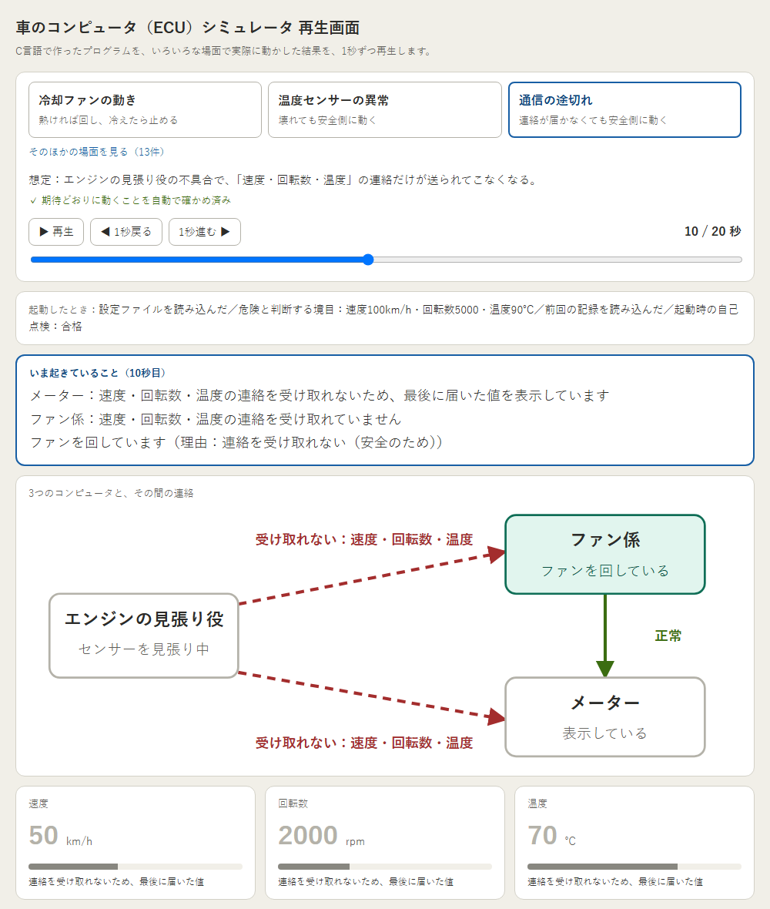
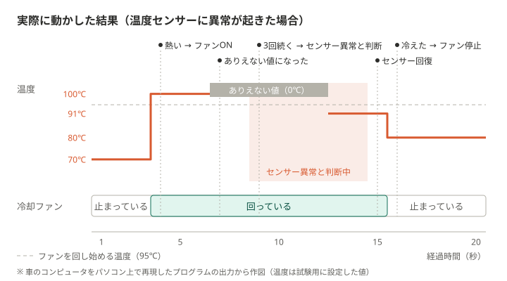

# automotive-ecu-learning

車載ソフトウェア開発への理解を深めるため、C言語、状態管理、診断、通信の基礎を段階的に学ぶ個人開発プロジェクト。

---

## このプログラムについて

車の中にある3つのコンピュータ（エンジンの見張り役・ファン係・メーター）の動きを、
C言語でパソコン上に再現したプログラム。エンジンの見張り役は温度などを1秒ごとに確かめ、異常を見つけると記録する。
ファン係は熱ければ冷却ファンを回し、メーターは運転席に表示する。3つは車の中の通信線（CAN）でやり取りし、
異常があっても安全側に動き続ける。



実際に動かした結果を1秒ずつ再生する画面。再生画面で見られる16通りのうち「通信の途切れ」を再生している途中（10秒目）で、
エンジンの見張り役からの連絡が、ファン係とメーターに届かなくなっている。
ファン係は本当の温度が分からないので安全のためファンを回し、メーターは最後に届いた値を表示している。

### 実際に動かした結果の例：温度センサーの異常（20秒間の流れ）

16通りのうち「温度センサーの異常」の20秒間を、1枚の図にしたもの。温度が上がるとファンを回し、
温度センサーの異常を見つけても、安全のためファンを回し続ける。センサーが元に戻り、温度が下がってからファンを止める。
ほかの対応は、下の「できること」の表と再生画面で見られる。



### できること

| 分類 | 場面 | プログラムの動き |
| --- | --- | --- |
| センサー | 速度・回転数・温度のどれかが危険な値 | 警告を出し、危険になった瞬間を記録する（そのときの車の状態も1回だけ保存） |
| | 危険な値が3回続く | そのセンサーは異常と判断し、安全な値（停車・アイドリング・常温相当）に置き換えて動き続ける |
| | 正常な値が3回続く | 回復と判断して、元の値に戻す |
| | 複数のセンサーが同時に異常 | それぞれ別々に判断・記録する |
| 冷却ファン | 温度の上下 | 熱ければ回し、冷えたら止める。境目の温度で細かくON/OFFを繰り返さない |
| | 温度センサーの異常 | 本当の温度が分からないので、安全のため回し続ける |
| コンピュータ間の通信 | 連絡が3回続けて届かない | 途切れと判断して記録する。メーターは最後の値を「途切れ」と示して表示し、ファンは安全側（回す）に倒す |
| | 速度・回転数・温度の連絡に、ありえない値が入っている | 途切れと同じく異常として扱い、記録する |
| | 3回続けて届くようになる | 回復と判断する |
| | ファン係からの連絡が途切れる | メーターが「ファン係の異常」として記録する |
| 起動・終了 | 起動するとき | 設定と記録を読めたかを自己点検する |
| | 設定ファイルが無い・壊れている | 決めてある値で動き続ける |
| | 記録ファイルが無い・壊れている | 記録ゼロから始める |
| | 終了するとき | 故障の記録を保存し（保存に失敗したことも検出）、次の起動で引き継ぐ |
| | エンジンを切っている間 | 何もしない。かけ直すと、ファン係は判断をやり直す |
| 点検 | 整備工場での点検 | エンジンを切っているときだけ、点検用のコマンドで記録を全部、またはセンサーごとに消せる。おかしな命令は受け付けない |

上の表の16通りは、冒頭の再生画面で、1秒ずつ再生して見られる。ブラウザで次のURLを開く（インストールは要らない）。
[https://tanaka780.github.io/automotive-ecu-learning/viewer/](https://tanaka780.github.io/automotive-ecu-learning/viewer/)
（リポジトリの[viewer/index.html](viewer/index.html)を、GitHub Pagesで公開したもの。ダウンロードしてこのファイルを開いても動く）

### 取り組みの量（2026年10月時点）

- 期間：2026年6月〜（約4か月）。作業の記録（日報）60日分
- 26の段階に分けて、小さく作っては確かめる、を繰り返した
- C言語のプログラム約3,000行、テストのプログラム約3,700行
- 8つのシナリオ（車の使われ方の筋書き）を決め、上の表の16通りの対応を、自動テストと実際の実行で確かめている
- 自動テスト205件（部品ごとのテスト154件、全体を通して動かすテスト51件）

### 工夫したこと

- **わざと故障を起こして確かめる仕組み**：センサーの値を固定する・途中で変える、通信を途中で止める、
  エンジンを途中で切る・かけ直す、などを設定ファイルで起こせるようにし、故障したときの動きを毎回同じ条件で確かめられるようにした
- **時間を自由に進めるテストの仕組み**：20秒かかる動作確認を数ミリ秒で、毎回まったく同じ結果で
  動かせるようにした。これにより、普段のテストでは見つからなかった
  「タイミングによって冷却ファンが止まってしまう不具合」を2つ見つけて直した
- **AIは補助として使い、判断と説明は自分で行う**：方針は [docs/AI_workflow.md](docs/AI_workflow.md) に記載

詳しい仕組み・実行方法・学習の記録は、以下の各節と docs/ フォルダを参照。

---

## 概要

C言語未経験から始め、車載ECUで使われる考え方を小規模な実装で段階的に学ぶ。
実車ECUの再現が目的ではなく、「何をしたいコードか」「なぜその構成にしたか」を
自分で説明できる状態にすることを目指す。

---

## 学習目的

- C言語の基礎を理解する
- データの流れを追える設計を身につける
- 車載ソフトウェアで使われる考え方を小さく段階的に理解する
- 学習過程をGitHubに記録し、第三者に説明できる状態にする

---

## プロジェクトの方向性

リポジトリ名（automotive-ecu-learning）が示す通り、当初からC言語で自動車関連プログラムを作ることを目的としていた。Phase1〜9では、その足がかりとして、センサ・DTC・ログ・永続化・設定ファイル等、自動車関連プログラムで使われる個々の簡単な機能を1つずつ作りながら学んできた。これらが揃ってきた現在は、それらを統合し、「車両状態を模擬し、異常を検出・診断・記録し、電源再投入後も診断情報を保持できるECUソフトウェアシミュレータ」として完成させる方向へ焦点を移している。

Phase10以降も新しい技術（Timer・Scheduler・CAN・Watchdog・Python等）の学習自体は続くが、テーマを選ぶ基準は「学習順序として妥当か」から「ECUの完成ストーリーに必要か」（CLAUDE.md記載の判断順序）へ変わる。

Phase1〜9はこの完成目標に向けた基礎実装・設計基盤の構築期間として位置付ける。Phase10以降の方向性は docs/study_plan.md を参照。代表的な車両シナリオ（正常走行／故障発生／診断コマンド／電源再投入／設定ファイル異常時のフェイルセーフ／通信故障／冷却ファン制御／水温センサ故障時の冷却ファン制御）は docs/scenarios.md を参照。

---

## ドキュメント

| ファイル | 内容 |
| --- | --- |
| [docs/project_context.md](docs/project_context.md) | 現在の実装状況・モジュール構成 |
| [docs/study_plan.md](docs/study_plan.md) | 学習計画とPhase構成 |
| [docs/scenarios.md](docs/scenarios.md) | 車両シナリオの定義 |
| [docs/learning_journal.md](docs/learning_journal.md) | 学んだことの理解メモ |
| [docs/daily_log/](docs/daily_log/) | 日ごとの作業記録 |
| [docs/AI_workflow.md](docs/AI_workflow.md) | AI活用方針 |
| [docs/images/](docs/images/) | このREADMEの図（再生画面の画像・実際に動かした結果の図） |

---

## 開発環境

- OS: Windows / WSL2 Ubuntu
- Editor / AI: ChatGPT, Claude
- Compiler: gcc (`-Wall -Wextra -std=c11`)
- Python 3（シナリオ検証`make scenario`、READMEの図・再生画面のデータ作成用。標準ライブラリのみ使用）
- Microsoft Edge（Windows側。冒頭の再生画面の画像を撮り直すときだけ使う）

---

## 実行方法

```bash
make clean && make && make run
```

テスト（diag.c・persist.c・stats.c・alert.c・ignition.c・cmd.c・config.c・fixture.c・validate.c・faultmgr.c・timer.c・scheduler.c・debounce.c・can.c・dtc_status.c・can_diag.c・can_fault.c・fan_ctrl.c・fan_ecu.c の動作確認、固定値データ使用。Phase13より[Unity](https://github.com/ThrowTheSwitch/Unity)形式に統一）:

```bash
make test
```

テストカバレッジ計測（Phase23。19テストターゲットそれぞれについて、担当モジュール1つのgcov実行行数割合を表示。`lcov`等によるプロジェクト全体の合算は未導入）:

```bash
make coverage
```

シナリオ検証（Phase25。`sensor_sim`をPythonから実行し、[docs/scenarios.md](docs/scenarios.md)の期待結果と照合する。現在は設定ファイル異常時のフェイルセーフ・故障発生（Degraded確定まで）・電源再投入・冷却ファン制御・水温センサ故障時の冷却ファン制御・エンジンを切ってかけ直したときのファン制御。`sensor_sim`の1回の実行に約20秒かかり、全体で8回実行するため約2分30秒かかる。冷却ファンの3条件は、秒単位で照合するため`sensor_sim_virtual`で動かし、数ミリ秒で終わる）:

```bash
make scenario
```

シナリオ検証のうち、名前に指定した文字列を含むテストだけを実行する（例：`test_runs_to_the_end`。`make scenario`と違い`sensor_sim`・`sensor_sim_virtual`をビルドしないため、先に`make`と`make sensor_sim_virtual`を実行しておく）:

```bash
python3 -m unittest discover -s scenario_test -k test_runs_to_the_end
```

時間を仮想化した検証用のビルド（`sensor_sim`と同じ処理を、実際には待たずに仮想時間で進める。1回の実行は数ミリ秒で終わり、`fixture.txt`でセンサ値とイグニッションを固定すれば、同じ入力で出力が毎回同じになる）:

```bash
make sensor_sim_virtual && ./sensor_sim_virtual
```

「実際に動かした結果」の図（`docs/images/fan_run_example.svg`）の作り直し（`tools/fan_run_example_fixture.txt`の条件で仮想時間版を動かし、その出力から`tools/plot_fan_timeline.py`がSVGを描く。作業用のフォルダで動かすため、リポジトリ直下の`dtc_data.txt`は上書きしない）:

```bash
make sensor_sim_virtual && R=$(pwd) && W=$(mktemp -d) && cp tools/fan_run_example_fixture.txt $W/fixture.txt && (cd $W && $R/sensor_sim_virtual < /dev/null) | python3 tools/plot_fan_timeline.py > docs/images/fan_run_example.svg
```

再生画面（`viewer/index.html`）のデータの作り直し（`tools/make_viewer_data.py`が16の場面ごとに作業用のフォルダで仮想時間版を動かし、その出力を1秒ごとの画面の情報にまとめて`viewer/index.html`の中に書き込む。場面ごとの期待する出来事と1つでも食い違えば、書き込まずに止まる。リポジトリ直下の`dtc_data.txt`は上書きしない）:

```bash
make sensor_sim_virtual && python3 tools/make_viewer_data.py
```

冒頭の再生画面の画像（`docs/images/viewer_comm_example.png`）の撮り直し（WSLから、Windowsに入っているEdgeを画面なしで動かして撮る。作業用のフォルダに再生画面のコピーを作り、開いたときの場面と秒だけを「通信の途切れ」の10秒目に書き換える。書き換えられなかったときは、撮らずに止まる）:

```bash
W=$(mktemp -d) && sed 's/var scene = 0, index = 0,/var scene = 2, index = 9,/' viewer/index.html > $W/shot.html && grep -q 'var scene = 2, index = 9,' $W/shot.html && "/mnt/c/Program Files (x86)/Microsoft/Edge/Application/msedge.exe" --headless=new --disable-gpu --hide-scrollbars --window-size=1000,1180 --screenshot="$(wslpath -w $W/shot.png)" "$(wslpath -w $W/shot.html)" && cp $W/shot.png docs/images/viewer_comm_example.png
```

---

## 現在の実装

| 機能 | 概要 |
| --- | --- |
| センサシミュレーション | 車速・RPM・水温をランダム更新・表示 |
| 統計表示 | 20サンプル分の最小・最大・平均を表示 |
| アラート表示 | 閾値を超えたセンサ値を警告表示 |
| センサ状態表示 | NORMAL / WARNING / CRITICAL の3段階で状態を分類・表示 |
| 固定幅整数型 | センサ値・統計値を `uint8_t` / `uint16_t` / `uint32_t` で型明示 |
| DTC記録 | CRITICALに入った瞬間を検出し、センサ別の発生回数と状態区分（ACTIVE / HISTORY）を記録・表示 |
| フリーズフレーム | 最初にCRITICALが発生した瞬間の全センサ値を1件だけ記録・表示 |
| イグニッション状態 | OFF/ONの状態をランダム更新・表示し、遷移した瞬間だけイベント表示。`fixture.txt`の`IGNITION=ON/OFF`で実行中ずっと固定することもできる。固定したときは、`IGNITION@N=ON/OFF`の行でN秒目以降の状態を切り替えられる |
| DTC永続化 | プログラム終了時にDTC記録をテキストファイルへ保存し、次回起動時に読み込んで継続する |
| 診断コマンド | プログラム終了時、イグニッションOFF時のみ`clear`コマンドを入力すると全DTC記録を、`clear <センサ名>`（speed/rpm/temp）を入力すると指定センサ1件分のDTC記録だけをリセットできる（UDS風のDTCクリアの簡易再現）。フリーズフレームは、その原因がクリア対象のセンサと一致する場合だけ合わせてリセットする。イグニッションON時はコマンドを受け付けず、受け付けなかった旨を表示する |
| 閾値の外部設定 | `config.txt`（`KEY=VALUE`形式）から警告・状態判定の閾値9個を読み込む。ファイルが無ければデフォルト値（`alert.h`/`status.h`のマクロ値）のまま動作する |
| ログレベル制御 | `config.txt`の`LOG_LEVEL`（0=INFO/1=WARNING/2=ERROR）で実行時のログ表示閾値を切り替える。`ALERT`はWARNING、`PERSIST`の保存失敗・データ破損はERROR、それ以外はINFOとして扱う |
| センサ固定値注入 | `fixture.txt`（`MODE=FIXED/RANDOM`形式）から固定センサ値を読み込む。`MODE=FIXED`ならセンサ値を固定値に差し替え、ファイルが無い／`MODE=RANDOM`なら従来通りランダムで動作する。`IGNITION=ON/OFF`の行があれば、`MODE`に関係なくイグニッションも固定する。`TEMP@N=値`の行があれば、N秒目以降の水温をその値に変える（冷却ファンのON/OFFを実行で確かめるため）。`IGNITION`で固定したときは、`IGNITION@N=ON/OFF`の行でN秒目以降のイグニッションも切り替える（エンジンを切っている間とかけ直したときの動きを、決まった秒で確かめるため） |
| 入力値域チェック | `config.txt`（閾値）・`fixture.txt`（センサ固定値）から読み込んだ値が、センサごとの物理的にありえる範囲（speed 0〜120／rpm 0〜6000／temp 25〜100）・LOG_LEVELの範囲（0〜2）に収まっているかを検証する。範囲外の値はそのキーだけ無視され、他のキーは反映される |
| 故障確定とFail-safe | センサ別にCRITICALが3回連続したら「一時的なノイズ」ではなく確定した異常（Degraded）とみなし（Debounce）、確定後はそのセンサの値をフェイルセーフ値に差し替えて警告・統計に反映する（縮退動作）。NORMALが3回連続したら復帰する（Recovery）。DTC記録・診断コマンド（`clear`）はDegraded状態と独立して動作する |
| 起動時自己診断（POST） | 起動時に`config.txt`・`dtc_data.txt`の読み込み結果を合成し、両方成功なら`[POST] Self-check passed`、いずれか失敗なら`[POST] Self-check did not pass, continuing with defaults`を表示する。判定結果で動作を変えるものではなく、既存のフェイルセーフ（デフォルト値継続）を可視化するのみ |
| 周期処理（Timer） | サンプルループの待機を、固定`sleep(1)`から単調増加クロック（`CLOCK_MONOTONIC`）による経過時間ベースの周期判定（`timer_is_due`）に置き換える。外部から見た1秒間隔の動作自体は変わらない |
| タスク管理（Scheduler） | 関数ポインタ＋周期を持つタスクを複数保持できるタスクテーブルを導入し、周期の待機・呼び出しをmain.cから委譲する。サンプル周期タスクに加え、Phase20でCAN送受信タスクを登録している |
| CAN通信 | 実プロセス分離は行わず、単一プロセス内でエンジンECU役（送信）・メーターECU役（受信）をSchedulerタスクとして表現する。ゲージデータ（speed/rpm/temp、1000ms周期）と警告灯データ（センサ別の確定異常フラグをビット詰め、200ms周期）を別メッセージ（CAN ID）で送受信し、受信側はTimeout（新しいフレームが来ない）・Invalid Data（validate.cでの値域外判定）をDebounce/Recovery（3回連続）で確定・復帰させる |
| CAN異常処理（DTC反映） | CANリンクのLost/Recoveryをdiag.cのDTC相当の記録（発生回数・状態区分NONE/ACTIVE/HISTORY）としてメッセージ別に記録する。診断コード管理の共通ロジック（エッジ検出→カウント→状態分類）はdiag.cから切り出し、物理センサ・CAN通信の両方から使う |
| ファン制御ECU（3ECU化） | 同じプログラムの中で、ファン制御ECU役がゲージデータ・警告灯データを受信し、水温（80℃以上でON・75℃以下でOFF、その間は前回を保つヒステリシス）でファンのON/OFFを決める。受信途絶・水温センサの確定異常の間はONにする（差し替え後の水温ではOFFにしない）。ファン状態を1000ms周期で送信し、メーターECU役が表示する。途絶はそれぞれのECUが自分の記録に残す（ファン制御ECU役は`[FAN-DTC]`、メーターECU役は`[CAN-DTC]`） |
| CAN Fault Injection | `can_fault.txt`の`MODE`で、指定したメッセージ・期間（プログラム起動からの経過時間）だけ意図的にCAN送信をスキップしTimeoutを再現する（`MODE=DROP`）、またはEngineStatusの送信データを値域外に差し替えInvalid Dataを再現する（`MODE=CORRUPT`、EngineStatusのみ対応）。can.c本体は変更せず、送信関数をラップする新規can_fault.cが担う。ファイルが無ければ従来通り注入なしで動作する |

---

## モジュール構成

| モジュール | 役割 |
| --- | --- |
| `main.c` | 初期化・ループ制御。起動時自己診断（POST、`config.txt`/`dtc_data.txt`の読み込み結果の合成）も担う |
| `sensor.c` | センサ値の更新・表示 |
| `stats.c` | 統計値の更新・表示 |
| `alert.c` | 閾値チェック・警告表示 |
| `status.c` | センサ値の状態分類（NORMAL / WARNING / CRITICAL）と表示 |
| `diag.c` | DTC（故障診断コード）の記録・表示、フリーズフレームの記録、全体クリア（`diag_clear`）とセンサ単位クリア（`diag_clear_sensor`）。発生回数・状態区分（NONE/ACTIVE/HISTORY）の更新自体は`dtc_status.c`に委譲する |
| `logger.c` | 出力の窓口の一元化。タグなし（`log_print`）・タグ付き（`log_print_tagged`）に加え、レベル付き（`log_print_leveled`）で`logger_set_level`が設定した表示閾値未満のログを抑制する |
| `ignition.c` | イグニッション状態（OFF/ON）の更新（ランダムの`ignition_update`、指定した状態の`ignition_set`）・遷移検出・表示 |
| `persist.c` | DTC記録のファイルへの保存・読み込み、成功/失敗のログ表示 |
| `cmd.c` | 標準入力から診断コマンド（`clear`／`clear <センサ名>`相当）を読み込み、解釈してDTC記録のクリア（全体／センサ単位）を要求する。想定外の入力は理由に応じて区別して通知する。イグニッションOFF時のみという受付条件を満たさない場合の通知（`cmd_notify_rejected`）も担う |
| `config.c` | 閾値9個（alert.c/status.c）とログレベル（`LOG_LEVEL`）の設定値を保持し、`KEY=VALUE`形式の設定ファイルから読み込む（ファイルが無ければデフォルト値のまま）。読み込んだ値はvalidate.cで値域チェックしたうえで反映し、alert.c/status.cの判定、およびlogger.cの表示閾値に反映される |
| `sim/fixture.c` | `fixture.txt`を`KEY=VALUE`形式で読み込む。`MODE=FIXED`なら`SPEED`/`RPM`/`TEMP`をvalidate.cで値域チェックしたうえでセンサ値に反映し、`main.c`はそれ以降の`sensor_update`呼び出しをスキップする。`MODE=RANDOM`・ファイル無し・`MODE`未指定の場合は何もせず、従来通りランダムに動作する。`IGNITION=ON/OFF`の行は別の関数（`fixture_load_ignition`）が読み、`MODE`に関係なくイグニッションを固定する（`main.c`は`ignition_update`の代わりに`ignition_set`を呼ぶ）。`TEMP@N=値`の行も別の関数（`fixture_load_temp_steps`）が読み、`MODE=FIXED`のとき、N秒目のサンプル以降の水温をその値に変える（`main.c`がサンプルごとに`fixture_temp_at`を呼ぶ）。センサ値は1秒に1回しか読まないので、ミリ秒ではなくサンプル番号で指定する。`IGNITION@N=ON/OFF`の行も同じ決め方で別の関数（`fixture_load_ignition_steps`）が読み、`IGNITION`の行で固定したときだけ、N秒目のサンプル以降のイグニッションをその状態にする（`main.c`がサンプルごとに`fixture_ignition_at`を呼ぶ） |
| `validate.c` | `SensorId`（sensor.h）をインデックスにした値域テーブル（min/max）を持ち、値がセンサごとの物理的な範囲内かを判定する（`validate_in_range`）。LOG_LEVEL用に0〜2の範囲チェック（`validate_log_level`）も別途提供する。config.c・fixture.cの両方から呼ばれる |
| `faultmgr.c` | センサ別に`status_check`の分類結果を見て、CRITICALの連続回数（Debounce）・確定後のNORMAL連続回数（Recovery）をカウントし、確定(Degraded)・復帰(Recovery)を判定する。Degraded中のセンサ値をフェイルセーフ値に差し替えたコピーを作る（`faultmgr_apply_safe_values`）。`main.c`は`diag_check`より後・`alert_check`/`stats_update`より前にこの差し替えを適用し、診断の正確性（raw値）と縮退動作の継続（フェイルセーフ値）を両立させる |
| `timer.c` | 周期判定（`timer_init`/`timer_is_due`）を提供する。時刻は`timer_get_elapsed_ms`から得るだけで、時計が実時間か仮想時間かは知らない。`main.c`はサンプルループの待機（旧`sleep(1)`）をこの周期判定のポーリングに置き換えている |
| `timer_clock.c` | 実時間の時計と待機。単調増加クロック（`CLOCK_MONOTONIC`）による起動からの経過時間取得（`timer_get_elapsed_ms`）と、指定したミリ秒だけ実際に待つ`timer_wait_ms`（`scheduler.c`のポーリングが使う）を提供する。検証用のビルド（`sensor_sim_virtual`）では`sim/timer_clock_virtual.c`に差し替わる |
| `scheduler.c` | 関数ポインタ・context・`timer.c`の`Timer`を1組にしたタスクを固定長配列（`SCHEDULER_MAX_TASKS`）で複数保持し、優先度を持たず登録順に周期判定・実行する（`scheduler_add_task`/`scheduler_run_due`）。各タスクは初回呼び出し時は周期を待たず即座に実行され（offset=0相当）、2回目以降は登録した周期(`period_ms`)ごとに実行される。`main.c`はサンプル周期タスク（`run_sample_cycle`）に加え、Phase20でCAN送受信タスクを3個、Phase26でファン制御ECU役の受信タスク2個・送信タスク1個と、メーターECU役のファン状態受信タスク1個を登録している（計8個で、`SCHEDULER_MAX_TASKS`（8）と一致） |
| `debounce.c` | 「一時的なノイズ」と「確定した異常」を区別する、Debounce（確定）・Recovery（復帰）の連続回数カウントだけを汎用化したもの（`debounce_update`）。対象（センサ値かCAN通信か等）の意味は一切知らない。`faultmgr.c`（センサ異常）・`can.c`（CAN通信異常）の両方から呼ばれる（Phase20、`validate.c`と同じ「2つ目の利用先ができたら汎用化する」基準で`faultmgr.c`から切り出した） |
| `can.c` | 実CANに準拠したフレーム構造（ID・DLC・data配列）を持つ`CanFrame`と、メッセージごとに最新の1フレームを保持する`CanBus`（バス役）を提供する。エンジンECU役はゲージデータ（`can_send_engine_status`）・警告灯データ（`can_send_fault_status`、送る側が作ったセンサ別の確定異常フラグ`CanFaultStatus`をビット詰め。`FaultManager`は知らない）を送信する。メーターECU役は受信時に送信タイムスタンプ（`timer_get_elapsed_ms`）から新しいフレームかを判定し（非ブロッキング方式）、Timeout（新しいフレームが来ない）・Invalid Data（`validate.c`での値域外判定）を`debounce.c`で確定・復帰させる（`CanLinkState`、`FaultManager`とは別カテゴリの通信専用状態）。確定・復帰のログも、受信した値の表示も持たず、受信したECU側が行う。ファン状態（ID 0x300、bit0=ファンON）の送信・受信も持つ（Phase26。送信はファン制御ECU役、受信はメーターECU役が使う） |
| `dtc_status.c` | DTCの状態区分（`DtcStatus`：NONE/ACTIVE/HISTORY）と、前回/今回の異常有無を比較して発生回数・状態区分を更新する`dtc_status_update`を提供する。異常の発生源（物理センサかCAN通信か等）は一切知らない汎用ロジックで、`diag.c`・`can_diag.c`の両方から呼ばれる |
| `can_diag.c` | CAN通信リンク別（`CanMessageId`）のDTC相当の記録（`CanDtcRecord`：発生回数・状態区分）を提供する。`CanLinkState`の前回/今回比較を`dtc_status.c`に渡して更新する（`can_diag_check`）。物理センサの`DtcEntry`（`SensorId`）とは別の識別子で持ち、実車のU-code（通信異常）とP-code（物理故障）の分離に倣う |
| `meter.c` | メーターECU役の受信処理。警告灯データ・ゲージデータ・ファン状態（Phase26で追加。途絶はファン制御ECUの異常として記録する）を`can.c`の受信関数で受け取り、CANリンクのLost/RecoveryをDTC相当の記録（`can_diag.c`）に反映して表示する。表示の関数（`meter_print_*`）と、Lost/Recoveryのログ（`[CAN] ... link lost/recovered`）もここに持つ（どちらも`can.c`から移した。文面は移す前と同じ）。受け取るcontext（`MeterContext`）はエンジン監視ECUの内部状態へのポインタを持たず、CANのbusとイグニッション状態だけを読む。Schedulerへの登録は`main.c`が行う（Phase26で`main.c`から移動） |
| `fan_ctrl.c` | ファン制御ECUの、水温によるファンのON/OFF判断（`fan_ctrl_decide`）。80℃以上でON、75℃以下でOFF、その間は前回の要求を保つ（ヒステリシス）。CANは扱わず、受け取った水温と前回の要求から今回の要求を返すだけ。`fan_ecu.c`から呼ばれる（Phase26） |
| `fan_ecu.c` | ファン制御ECU役の処理（Phase26）。警告灯データ・ゲージデータを受信し、CANリンクのLost/Recoveryを記録する（ログは`[FAN]`、DTC相当の記録の表示は`[FAN-DTC]`）。警告灯データを受けるたびに、受信途絶・水温センサの確定異常のどちらかがあればファンON、無ければ`fan_ctrl.c`の水温による要求でファン出力を決め、変わった瞬間だけ`[FAN] Fan ON (理由)`/`[FAN] Fan OFF`を出す。水温は、それより後に送られた最初の警告灯データで水温センサが正常と分かってから使う（確定・復帰の前後に、差し替え後の25℃で判断しないため）。イグニッションOFF→ONで判断の状態を戻し、新しく届いた水温を受け取るまでOFFのままにする。ファン状態として送る値（ファン出力）を返し、`main.c`が1000ms周期でbusへ送信する（ID 0x300）。受信監視状態（`CanMonitor`）とDTC相当の記録は、メーターECU役とは別に持つ |
| `sim/can_fault.c` | `can_fault.txt`（`MODE=DROP/CORRUPT/NORMAL`、`TARGET=ENGINE_STATUS/FAULT_STATUS/FAN_STATUS`、`START_MS`/`END_MS`）を読み込む。`MODE=DROP`は指定期間だけ`can.c`の送信関数（`can_send_engine_status`/`can_send_fault_status`、Phase26で`can_send_fan_status`も追加）の呼び出しをスキップしてTimeoutを再現する。`MODE=CORRUPT`はEngineStatusのみ対応し、送信専用の値域外データ（speed/rpm/temp全て`0xFF`）を持つ一時コピーを作って`can_send_engine_status`に渡すことでInvalid Dataを再現する（実センサ値は変更せず物理センサ診断には影響しない。FaultStatus・FanStatusとの組み合わせは無効な指定として注入なし扱い）。`can.c`本体は変更せず送信をラップするのみ |
| `sim/timer_clock_virtual.c` | 検証用の仮想時計。`timer_clock.c`の代わりにリンクして`sensor_sim_virtual`を作る。`timer_wait_ms`は待たずに時刻を進めるだけなので、タスクは常に周期ちょうどに実行される。CAN受信側の初期値（送信時刻0）と最初のフレームが重ならないよう、時刻は1000msから始める |
| `test/test_diag.c` | 固定値データによる diag.c の動作確認（`make test`で実行） |
| `test/test_persist.c` | 固定値データ・意図的に壊したデータによる persist.c の正常系・異常系の動作確認（`make test`で実行） |
| `test/test_stats.c` | 固定値データによる stats.c の動作確認（`make test`で実行）。サンプル投入用のヘルパーは test_common.c を使わずファイル内にローカルで定義 |
| `test/test_alert.c` | 標準出力キャプチャ（`freopen`＋`dup`/`dup2`）による alert.c の動作確認（`make test`で実行）。閾値境界・単独超過・複数同時超過時の警告出力を確認する |
| `test/test_ignition.c` | 標準出力キャプチャ（`freopen`＋`dup`/`dup2`）による ignition.c の動作確認（`make test`で実行）。OFF/ONの4パターン（遷移あり/なし）で、遷移した瞬間だけイベントが出力されることを確認する。`ignition_set`で前回の状態が`previous`に残ること、同じ状態を続けても遷移イベントは最初の1回だけであることも確認する |
| `test/test_cmd.c` | 固定値データによる `diag_clear`・`diag_clear_sensor`・`cmd_dispatch`（全体クリア／センサ単位クリア／不正なセンサ名／余分なトークン／空白のみ等）の動作確認（`make test`で実行）。標準入力を扱う `cmd_read_line` は対象外（`make run`での実行確認で扱う） |
| `test/test_config.c` | 固定値データによる `config_load` のファイルパース動作確認（`make test`で実行）。正常系（全9キーの反映）、異常系（未知のキー・値欠落・数値以外の行は無視される、値域外の値は無視される、キー重複時は後勝ち）を確認する |
| `test/test_fixture.c` | 固定値データによる `fixture_apply` のファイルパース動作確認（`make test`で実行）。正常系（`MODE=FIXED`で全キーの反映）、異常系（未知のキー・値欠落・数値以外の行は無視される、値域外の値は無視される、キー重複時は後勝ち、`MODE=RANDOM`時はセンサ値を変更しない）を確認する。`fixture_load_ignition`についても、ON/OFFの反映、行・ファイルが無い場合、不正な値の無視、後勝ち、`MODE`に関係なく有効なことを確認する。`fixture_load_temp_steps`/`fixture_temp_at`については、N秒目から切り替わること、行の順番によらないこと、不正なN・値の無視、同じNの後勝ち、行・ファイルが無い場合、行数の上限、`TEMP@N`行が`fixture_apply`・`fixture_load_ignition`の結果を変えないことを確認する。`fixture_load_ignition_steps`/`fixture_ignition_at`（`IGNITION@N`行）についても、N秒目から切り替わること、不正な行の無視と同じNの後勝ち、行が無い場合、行数の上限、ほかの読み込みの結果を変えないことを確認する |
| `test/test_validate.c` | 固定値による `validate_in_range`・`validate_log_level` の境界値確認（`make test`で実行）。speed/rpm/temp各センサの下限・上限・範囲外、不正な`SensorId`、LOG_LEVELの下限・上限・範囲外を確認する |
| `test/test_faultmgr.c` | 固定値による `faultmgr_check`・`faultmgr_apply_safe_values` の動作確認（`make test`で実行）。Debounce確定前後の境界、連続が途切れた場合のカウント数え直し、Recoveryの境界（WARNING止まりでは復帰しない）、複数センサの独立性、フェイルセーフ値差し替え時のraw非破壊を確認する |
| `test/test_timer.c` | timer.c の動作確認（`make test`で実行）。経過時間の単調増加、周期判定（`timer_is_due`）がinit直後はfalse・周期経過後はtrue・trueを返した直後は再びfalseに戻ることを確認する。実際の待機（数十ms）を伴う点が他のテストと異なる |
| `test/test_scheduler.c` | scheduler.c の動作確認（`make test`で実行）。登録直後の初回呼び出しが周期を待たず即座に実行されること、初回実行後は周期(`period_ms`)が経過するまで次が実行されないこと、上限（`SCHEDULER_MAX_TASKS`）を超える登録が`false`を返すことを確認する。timer.cと同様、実際の待機を伴う |
| `test/test_debounce.c` | debounce.c の動作確認（`make test`で実行）。確定・復帰それぞれの閾値到達前後の境界、連続が途切れた場合のカウント数え直し、confirm_threshold/recover_thresholdが異なる値でも独立して動作することを確認する |
| `test/test_can.c` | can.c の動作確認（`make test`で実行）。ゲージデータ・警告灯データそれぞれの送受信の往復一致、未受信が3回連続した場合のTimeout確定、値域外データが3回連続した場合のInvalid Data確定、有効受信が3回連続した場合のRecoveryを確認する。ファン状態の往復一致（ON・OFF）とTimeout確定も確認する。timer.c/scheduler.cと同様、Timeout解除の確認には実際の待機を伴う |
| `test/test_dtc_status.c` | dtc_status.c の動作確認（`make test`で実行）。異常発生の瞬間（エッジ）だけ発生回数が増えること、継続中は二重カウントしないこと、解消時のHISTORY遷移、再発生時の再カウントを確認する |
| `test/test_can_diag.c` | can_diag.c の動作確認（`make test`で実行）。`CanLinkState`のLost確定・Recovery復帰によるDTC相当の記録の更新、メッセージ（EngineStatus/FaultStatus）間の独立性を確認する |
| `test/test_can_fault.c` | can_fault.c の動作確認（`make test`で実行）。Drop判定（`can_fault_is_dropped`）・Corrupt判定（`can_fault_is_corrupted`）の対象メッセージ一致・時間範囲の境界と、`can_fault.txt`のファイルパース（`can_fault_load`の正常系・異常系、`MODE=CORRUPT`+`TARGET=FAULT_STATUS`が無効な組み合わせとして注入なし扱いになることを含む）を確認する。ファン状態（`TARGET=FAN_STATUS`）の読み込み・Drop判定・送信のラップも確認する（Phase26） |
| `test/test_fan_ctrl.c` | fan_ctrl.c の動作確認（`make test`で実行）。ON閾値・OFF閾値ちょうどでの切り替わり、閾値の間では前回の要求を保つこと、閾値の外側では前回の要求に関係なく決まること、水温が上がって下がる一巡でのOFF→ON→OFFを確認する。閾値の数字は直接書かず、`fan_ctrl.h`のマクロとその±1で境界を確かめる |
| `test/test_fan_ecu.c` | fan_ecu.c の動作確認（`make test`で実行）。水温を受け取るまでOFFのままなこと、水温によるON/OFF、水温センサの確定異常・受信途絶でのON、確定異常の間は水温による要求を更新しないこと、イグニッションOFF→ONでOFF前の水温を使わないこと、送る値がファン出力と一致し、OFF→ONの直後もOFF前の出力を送らないことを確認する。水温センサの確定・復帰の瞬間に、確定前の警告灯データと差し替え後の25℃、復帰後の警告灯データと確定中の25℃を組み合わせてOFFにしないこと、送信時刻が一周しても判定できることも確認する。busにフレームを直接書いて受信させるため、実際の待機は伴わない |
| `scenario_test/test_config_failsafe.py` | `sensor_sim`を一時ディレクトリで最後まで実行し、標準出力・終了コードを設定ファイル異常時のフェイルセーフシナリオの期待結果と照合する結合テスト（`make scenario`で実行、Python標準の`unittest`）。`config.txt`が無い場合の2条件（`dtc_data.txt`も無い／`dtc_data.txt`は読み込める）と、`config.txt`が壊れている場合の1条件を確認する |
| `scenario_test/test_fault_occurrence.py` | `fixture.txt`でセンサ値とイグニッション（ON）を固定して`sensor_sim`を実行し、故障発生シナリオの期待結果と照合する結合テスト（`make scenario`で実行）。水温だけがCRITICALの条件で、警告・DTC・フリーズフレーム・3サンプル目でのDegraded確定・確定後のフェイルセーフ値（警告・統計・メーター表示）を、車速と水温が同時にCRITICALの条件で、両方のDTC記録・フリーズフレームの原因（Speed）・Degradedのセンサだけの差し替えを確認する。値は最後まで固定したままなので、正常値に戻ってのRecoveredはこのテストの対象外（水温のRecoveredは`test_fan_control.py`で確認する） |
| `scenario_test/test_power_cycle.py` | 同じ一時ディレクトリで`sensor_sim`を3回続けて実行し、電源再投入シナリオの期待結果と照合する結合テスト（`make scenario`で実行）。初回起動がDTC0件から始まること、終了時の保存、2回目（イグニッションOFF固定でDTCが更新されない）の起動直後にDTC・フリーズフレームが引き継がれていること、`dtc_data.txt`の有無によるPOSTの違い、3回目（再びCRITICAL）に発生回数が2になりフリーズフレームは上書きされないことを確認する |
| `scenario_test/test_fan_control.py` | `fixture.txt`の`TEMP@N`行で実行の途中に水温を変えて`sensor_sim_virtual`を実行し、冷却ファン制御・水温センサ故障時の冷却ファン制御の期待結果と照合する結合テスト（`make scenario`で実行）。80℃でON・75〜80℃の間は保持・75℃でOFFになる秒、メーターに1秒遅れでファン状態が届くこと、水温センサの確定中も、閾値の間の水温で復帰した後もファンを止めず、75℃以下に下がってからOFFにすることを確認する。`IGNITION@N`行でエンジンを途中で切ってかけ直し、切っている間は何もしないこと、かけ直すとファン制御ECUが判断をやり直すこと、切っている間を通信の途絶として記録しないことも確認する。確定の瞬間の一瞬OFF（タスクの開始がずれたときだけ起きる）は、このテストでは見張れず、`test_fan_ecu.c`が見張る |
| `scenario_test/sensor_sim_runner.py` | シナリオ検証で共通に使う`sensor_sim`の実行関数。一時ディレクトリで1回実行する`run_sensor_sim`と、指定したディレクトリで実行する`run_in_dir`（同じディレクトリで2回実行し、保存されたファイルを引き継ぐ場合に使う）を提供する。どちらも実行ファイルを選べ、既定は`sensor_sim`（`test_fan_control.py`は`sensor_sim_virtual`を渡す）。ファイル名が`test_`で始まらないため、テストとしては実行されない。各テストファイルが先頭でこのフォルダを`import`の検索先に加えるため、モジュール名を指定した実行（`python3 -m unittest scenario_test.test_xxx`）でも見つかる |
| `test/test_common.c` | test_diag.c・test_persist.c・test_cmd.c・test_alert.c・test_config.cで共通のテスト補助関数（サンプル投入用の`test_feed`/`test_run_sample`、デフォルトの`ConfigData`を返す`test_default_config`）を提供する。Phase13でテスト自体をUnity形式に統一したため、結果判定・サマリ表示（旧`test_check`/`test_summary`）の役割はUnityに置き換わった |

---

## 学習フェーズ

| Phase | テーマ | 状態 |
| --- | --- | --- |
| Phase1 | C基礎・データフロー・責務分割 | 完了 |
| Phase2 | DTC（故障診断コード）管理 | 完了 |
| Phase3 | logger（出力層の共通化） | 完了 |
| Phase4 | 状態遷移（イグニッション状態管理） | 完了（OFF中は他モジュール呼び出しをスキップ。サイクルまたぎのDTC/統計はリセットせず継続） |
| Phase5 | DTCの永続化（ファイルI/O） | 完了（永続化の実装、エラーハンドリング、test/test_persist.cによるテスト、test_diag.cとの重複処理のtest_common.h/.cへの切り出し、stats.cへの自動テスト追加まで完了） |
| Phase6 | 標準出力を伴う判定処理のテスト（標準出力キャプチャ） | 完了（alert.c・ignition.cの自動テスト（test/test_alert.c・test/test_ignition.c）、Makefile統合まで完了） |
| Phase7 | 診断コマンド入力（UDS風のDTCクリア） | 完了。拡張バックログのうち、クリア範囲の指定（`clear <センサ名>`）、拒否理由の区別（不正なセンサ名／想定外コマンドの区別）、受付条件の制限（イグニッションOFF時のみ）まで対応済み。イグニッションOFF遷移時に受付タイミングを変える案はTimer/Scheduler以降に先送り |
| Phase8 | Config（閾値の外部化） | 完了（`config.h`/`config.c`の新規作成、`main.c`への組み込み、`alert.c`/`status.c`への反映、非デフォルトconfigでの判定反映を確認する自動テスト、`test_config.c`によるファイルパースの正常系・異常系テストまで完了） |
| Phase9 | Logger拡張（ログレベル） | 完了（`LogLevel`と`log_print_leveled`の新設、`ConfigData`への`log_level`追加、`main.c`からの配線、既存ログ呼び出しの`log_print_leveled`への置き換えまで完了。`config.c`自身の読み込み結果ログ2箇所は、表示閾値が確定する前に呼ばれるため対象外とした） |
| Phase10 | 車両シナリオの定義 | 完了。正常走行／故障発生／診断コマンド（DTCクリア）／電源再投入／設定ファイル異常時のフェイルセーフ（リンプホームモード）／通信故障（将来項目）の6シナリオを`docs/scenarios.md`に整理した |
| Phase11 | 固定値注入によるシナリオ再現の仕組み構築 | 完了（`fixture.h`/`fixture.c`の新規作成、`main.c`への組み込み、`test/test_fixture.c`による自動テスト、`make run`での動作確認まで完了） |
| Phase12 | 入力妥当性チェック（Guard Clause） | 完了（`validate.h`/`validate.c`の新規作成、config.c/fixture.cへの組み込み、`test/test_validate.c`による自動テスト、`test_config.c`/`test_fixture.c`への値域外ケース追加、`make run`での実行確認まで完了） |
| Phase13 | Unity試用 | 完了（自作`test_common.c`パターンと比較しUnity採用を決定、既存9テストターゲット全てをUnity形式（`vendor/unity/`）に移行。検証内容は変更なし） |
| Phase14 | MISRA対応 | 完了（cppcheckのMISRA C:2012アドオンで検出した12ルールを判断。5.9/8.9/10.4/10.8/15.6/15.7・17.7（26件、`persist.c`の保存失敗検出修正含む）・12.1/18.4は適用、21.6/21.10・15.5は不採用（理由は既知の制約参照）） |
| Phase15 | 故障確定とFail-safe（Debounce→Degraded mode→復帰） | 完了（新規`faultmgr.h`/`faultmgr.c`を作成。センサ別にDebounce（3回連続CRITICAL）で確定、Degraded中はフェイルセーフ値に差し替えて`alert_check`/`stats_update`に渡す縮退動作、Recovery（3回連続NORMAL）で復帰。`status_check`/`diag_check`は常にraw値を見てDTCの正確性を保つ。`test/test_faultmgr.c`による自動テスト、`make run`での実行確認まで完了） |
| Phase16 | 起動時自己診断（POST） | 完了（`main.c`に、`config.txt`・`dtc_data.txt`の読み込み結果を合成する自己診断を追加。判定結果はログ出力のみで動作は変えず、既存のフェイルセーフ（デフォルト値継続）を可視化する。ロジックが単純なためmain.cにインラインで実装し、main.cはUnityのテストターゲットに含められないため自動テストは対象外とし、`make run`で4パターン全て確認した） |
| Phase17 | DTO整理 | 完了（複数ECU化構想を見据え、エンジン監視ECUが送信する想定のデータ範囲（生センサ値＋確定異常フラグ）、メーターECUが受信する範囲、既存構造体を流用するか専用型を新設するかの方針を決定した。CAN通信の実装は伴わず、CAN Phase着手時に反映する） |
| Phase18 | Timer（周期処理の時間管理基盤） | 完了（新規`timer.h`/`timer.c`を作成。単調増加クロック`CLOCK_MONOTONIC`による経過時間取得と、周期判定`timer_is_due`を実装。`main.c`のサンプルループの`sleep(1)`をこの周期判定のポーリングに置き換えた。コールバックによる自動起動は見送り、Schedulerへの土台となる最小限の機能に留めた。`test/test_timer.c`による自動テスト、`make run`での実行確認まで完了） |
| Phase19 | Scheduler（周期処理のタスク管理基盤） | 完了（新規`scheduler.h`/`scheduler.c`を作成。関数ポインタ＋周期を持つタスクを固定長配列で複数保持し、優先度は持たず登録順に判定・実行する最小構成を実装した。`main.c`はサンプル周期タスク（`run_sample_cycle`）を1個登録し、旧`timer_is_due`のポーリング待機を委譲する形に変更。実車OSEK/AUTOSAR OSのoffset（初回起動までの時間）概念を踏まえた上で、タスクが1個のみの現状ではoffsetの効果が無いためoffset機構は実装せず、初回呼び出しは即座に実行する形（offset=0相当）とし、既存の動作（20サンプル・1000ms間隔・初回即時実行）を変えていない。`test/test_scheduler.c`による自動テスト、`make run`での実行確認まで完了） |
| Phase20 | CAN通信（エンジンECU役→メーターECU役のメッセージ送受信） | 完了（実現方式はSocketCAN不採用・自作フレームシミュレーション採用、プロセス構成は単一プロセス内でSchedulerタスクとして表現する方針を決定。新規`can.h`/`can.c`を作成し、ゲージデータ（`CAN_ID_ENGINE_STATUS`、1000ms周期）・警告灯データ（`CAN_ID_FAULT_STATUS`、確定異常フラグをビット詰め、200ms周期）の2メッセージを実装。受信側はTimeout（新しいフレーム未着）・Invalid Data（`validate.c`での値域外）を確定・復帰させる仕組みが必要になり、`faultmgr.c`のDebounce/Recoveryカウント処理を汎用化した新規`debounce.c`に切り出して両方から使う設計にした（`FaultManager`とは別カテゴリの`CanLinkState`として持ち、実車のDTC分類P-code/U-codeの分離に倣う）。`test/test_debounce.c`・`test/test_can.c`による自動テスト、`make run`での実行確認まで完了） |
| Phase21 | CAN異常処理（Timeout/Invalid DataのDTC反映） | 完了（`diag.c`の`diag_check`から発生回数・状態区分（NONE/ACTIVE/HISTORY）の更新ロジックを新規`dtc_status.c`へ切り出し（物理センサ・CAN通信の共通利用、`debounce.c`と同じ切り出し基準）、新規`can_diag.h`/`can_diag.c`で`CanLinkState`のLost/RecoveryをDTC相当の記録として持たせた。識別子（`SensorId`とCAN用の`CanMessageId`）は分けたまま記録ロジックだけを共有する設計とし、AUTOSAR Demのような完全統一は見送り保留中の候補へ記録した。`test/test_dtc_status.c`・`test/test_can_diag.c`による自動テスト、既存`test_diag.c`（リファクタリング後も検証内容不変）まで確認済み。`make run`ではCAN-DTCの表示形式・既存動作への影響が無いことを確認したが、Lost/Recovery自体の自然発生にはCAN用のFault Injection機構が必要と判明し、実行時の再現は対象外とした（Phase22で対応）） |
| Phase22 | CAN Fault Injection（通信故障の意図的な発生） | 完了（新規`can_fault.h`/`can_fault.c`を作成。`can.c`本体は変更せず送信関数（`can_send_engine_status`/`can_send_fault_status`）をラップし、`can_fault.txt`で指定したメッセージ・期間（プログラム起動からの経過時間）だけ意図的に送信をスキップしてTimeoutを再現する。実装時、`timer_get_elapsed_ms`がシステム起動からの経過時間を返す（プログラム起動からではない）ため期間指定が機能しないバグが`make run`で発覚し、基準時刻（`base_ms`）を持たせて差分を取る形に修正した。`test/test_can_fault.c`による自動テスト、`make run`でCANリンクのLost/Recoveryの実行時再現まで確認済み。拡張バックログとして、EngineStatusのInvalid Data注入（`MODE=CORRUPT`、送信専用の破損コピーのみ改ざんし実センサ値は変更しない設計）にも対応した。`test/test_can_fault.c`に4件追加（10→14件）、`make run`でEngineStatusのInvalid Data確定・DTC反映まで確認済み） |
| Phase23 | テストカバレッジ計測（gcov） | 完了（17テストターゲットそれぞれについて、既存のソース構成を再利用した`--coverage`付きビルド（`xxx_cov`）を追加し、担当モジュール1つのgcov実行行数割合を`make coverage`で一括表示できるようにした。プロジェクト全体を1つの数値に合算する`lcov`導入は、共有モジュールが複数ターゲットにまたがる場合に自動では合算されないことを実験で確認した上で、必要性が高まった場合の拡張候補として見送った。`main.c`はUnityとリンクできないため対象外のまま） |
| Phase24 | フォルダ構成の再編成（BSW/アプリ層分割） | 完了（配置の検討（タスク1）のみ実施。PC依存の処理はファイル単位ではなく各ファイル内の一部の関数に限られており、ファイル単位で層に振り分けると層の意味が崩れるため、`src/`の移動は行わず、ドキュメント類の`docs/`への集約のみ実施した） |
| Phase25 | Python自動検証（シナリオの結合テスト） | 完了（`sensor_sim`に外から入力を与え、`docs/scenarios.md`の期待結果と照合する結合テストとして、検証対象のシナリオとテストの枠組み（`unittest`）を決定した。設定ファイル異常時のフェイルセーフ（`config.txt`が無い場合・壊れている場合）は、`sensor_sim`本体を変更せずに`make scenario`で自動検証できる。PC上の検証専用モジュール（`fixture.c`・`can_fault.c`）を`sim/`へ移動した。`fixture.txt`の`IGNITION=ON/OFF`でイグニッションを固定できるようにし、故障発生（Degraded確定まで）・電源再投入も自動検証できる。3シナリオ・34テストとも、期待値やCの動作をわざと変えると対応するテストだけが落ちることを確認した） |
| Phase26 | 3ECU化（ファン制御ECUの追加） | 完了（3ECUは、プロセスを分けずに同じプログラムの中でECUごとのモジュールに分けて動かすことを決定した。流用するエンジン監視ECUは、モジュールのロジックを変えない。下準備として、ヘッダファイルだけを変えた場合にも実行ファイル・テストが作り直されるようにした。メーターECU役の受信処理を`main.c`から新規`meter.c`へ移し、通信故障を入れた実行の出力が移す前と変わらないことを確認した。新しく書くECUのコードにも、MISRA 15.5（単一出口）は適用しない。ファン制御ECUの、水温によるON/OFFのヒステリシス判定（`fan_ctrl.c`）を実装し、単体テストで確認した。CANリンクのLost/Recoveryのログを、受信したECU（`meter.c`）が出す形に変えた。ファン状態のメッセージ（ID 0x300）の送受信を追加した。ファン制御ECU役（`fan_ecu.c`）の受信と、CANリンクのLost/Recoveryの記録を実装した。続けて、受信途絶・水温センサの確定異常・水温によるファン出力の判断と、ファン状態の送信（1000ms周期）を実装した。メーターECU役で、ファン状態の受信・表示・途絶の記録も実装した。`can_fault.txt`の`TARGET=FAN_STATUS`でファン状態の送信を止め、メーターECU役がファン制御ECUの異常を記録・表示することを実行で確かめた。水温の変化に対する判断は、Phase26の完了後に`fixture.txt`の`TEMP@N`行で実行中に水温を変えられるようにして、実行で確かめた） |
---

## 既知の制約

- 実車ECUや実CAN通信とは接続していない
- センサ値は学習用の簡易モデルであり、実車の物理モデルではない
- DTC永続化データの読み込みは、値の個数が正しければ読み込み成功と判定しており、個々の値が意味的にありえる範囲かまではチェックしていない
- 診断コマンドは`clear`／`clear <センサ名>`（speed/rpm/temp）のみに対応しており、大文字小文字を区別し前後の空白もトリムしない完全一致判定。拒否理由の区別も「不正なセンサ名」「イグニッションON中で受付不可」「それ以外の想定外コマンド」の3種類にとどまる。他のUDS診断サービスは再現していない
- 診断コマンドの受付タイミングはサンプルループ終了後の1回のみで変わっていない。イグニッションOFFへ遷移した瞬間を検出して受け付ける（実際の駐車中スキャンツール接続に近い挙動）わけではなく、ループ終了時点の状態がたまたまOFFかどうかで受付可否が決まる
- 設定ファイル（config.txt）の値は、validate.cでセンサごとの物理的な値域内か（`LOG_LEVEL`は0〜2の範囲内か）をチェックしており、範囲外ならそのキーを無視する。ただし`STATUS_SPEED_WARN`と`STATUS_SPEED_CRIT`のような、閾値同士の大小関係（WARNがCRITより大きい等の矛盾）はチェックしていない
- ファン制御ECUのON/OFFの閾値（80℃・75℃）は`fan_ctrl.h`のマクロで、`config.txt`からは変えられない（変えるにはビルドし直す必要がある）。`config.c`はエンジン監視ECU側のモジュールのため、ファン側の値は加えていない
- ログレベル（`LOG_LEVEL`）を上げても、`config.c`自身の読み込み結果ログ（設定ファイルの有無・読み込み完了の通知）は常に表示される。表示閾値はそのconfig読み込みの結果として決まるため、config読み込み自体のログをその閾値で制御できない
- 固定値注入ファイル（fixture.txt）の値も、config.txtと同様にvalidate.cで値域チェックされる。実行の途中で値を変えられるのは水温（`TEMP@N`）だけで、車速・回転数は実行中一定の単一固定値のみ。イグニッションを途中で切り替える`IGNITION@N`は、`IGNITION`の行で固定したときだけ使われ、ランダムなイグニッションには混ぜない
- cppcheckのMISRA C:2012アドオン（`--addon=misra`）が検出する21.6/21.10（標準入出力・time.h使用制限）と15.5（単一出口）には準拠していない。前者はPC上のシミュレータという設計前提そのもの（`printf`/`fopen`/`time`を使う）と、後者はガード節（早期return）による可読性重視の設計と衝突するため、意図的に不採用としている
- 故障確定（Debounce/Degraded/Recovery、`faultmgr.c`）の状態は、DTC記録（`persist.c`）とは異なり電源再投入をまたいで保存されない（プログラム起動のたびに未確定状態から再開する）。診断コマンド（`clear`）でDTCをクリアしても、Degraded状態自体はリセットされない（独立した状態として扱う）
- 起動時自己診断（POST）は`config.txt`/`dtc_data.txt`が読み込めたかだけを見ており、内容が意味的に正しいか（値域・整合性）までは判定しない。またmain.cはUnityのテストターゲットに含められない（main関数が重複しリンクできない）ため、POSTを含むmain.c内の処理全般は単体テストの対象外で、`make run`での実行確認が中心になる。このうち`config.txt`・`dtc_data.txt`の有無によるPOSTの結果、故障発生時（Degraded確定まで）の処理の流れ、電源再投入をまたいだDTCの保存・読み込みは、`sensor_sim`を外から実行するシナリオ検証（`make scenario`、Phase25）で自動検証している。`TEMP@N`行による水温の差し替えから冷却ファンの流れまでと、`IGNITION@N`行によるイグニッションの切り替えも、`sensor_sim_virtual`を使うシナリオ検証で自動検証している
- DTC発生回数（`DtcEntry.count`、`uint8_t`）は上限（255）を超えると飽和させず0に巻き戻る。dtc_data.txtで永続化され複数回の起動をまたいで積み上がる値のため理論上は起こりうるが、通算256回以上の発生が必要であり現実的な発生頻度は低い
- `config.txt`/`fixture.txt`の数値パース（`sscanf`の`%d`）は、値がint型の範囲を超える場合の動作を保証していない（値域チェック`validate_in_range`が働く前の段階のため）。ローカルで自分が編集する前提のファイルであり、外部・未信頼な入力を想定した対策はしていない
- CAN通信（`can.c`）は実プロセス分離・実IPC（SocketCAN等）を使わず、単一プロセス内の共有メモリ（`CanBus`）でエンジンECU役・メーターECU役を表現している。実チップ間の物理的な通信遅延やバス調停の実態は再現していない（IDは実車の優先度慣例に合わせて値を割り当てているが、実際のアービトレーションには使っていない）
- CAN受信のTimeout判定は、受信タスクの呼び出し周期が対応する送信タスクの周期とほぼ一致している前提（例: ゲージは両方1000ms）で「前回チェック時から新しいフレームが来たか」を見ており、実車のような絶対時間（経過ms）のしきい値比較ではない。受信タスクの周期を送信タスクより短くすると、送信側は正常でも受信側のチェックが空振りを繰り返すだけで確定回数（3回）に達してしまい、実際より短い時間でTimeoutと誤判定する
- CAN通信リンクの状態（`CanLinkState`、Timeout/Invalid Data確定）は、DTC記録（`persist.c`）や故障確定（`faultmgr.c`）とは異なり、電源再投入をまたいだ保存はしていない（プログラム起動のたびに`CAN_LINK_OK`から再開する）。診断コード（DTC）への反映はPhase21（`can_diag.c`）で対応済みだが、この反映用の記録（`CanDtcRecord`）自体も同様に永続化はしていない
- CAN送信タスク・受信タスクは共にイグニッションON時のみ動作するため（OFF中はECU無通電という既存の前提に合わせる）、`can_fault.txt`が無い通常の`make run`ではCANリンクのLost/Recoveryが自然に発生しない（OFF中は送受信双方が止まり、ONに戻れば直ちに新しいフレームを受信するため）。`can_fault.txt`（Phase22）で意図的にTimeoutを発生させれば`make run`でも再現できる
- CAN Fault Injection（`can_fault.c`）はTimeout（送信スキップ、`MODE=DROP`）とInvalid Data（`MODE=CORRUPT`、EngineStatusのみ対応）に対応する。FaultStatus・FanStatusはビットフラグのみでInvalid Data判定ロジックが無いため、`MODE=CORRUPT`と`TARGET=FAULT_STATUS`・`TARGET=FAN_STATUS`の組み合わせは無効として注入なし扱いになる。また1回の実行で注入できるのは1メッセージ（`TARGET`）・1種類（`MODE`）のみで、`START_MS`/`END_MS`の大小関係（矛盾した指定）もチェックしていない
- CANリンクのDTC相当の記録（`can_diag.c`）は、メーターECU役（`[CAN-DTC]`）とファン制御ECU役（`[FAN-DTC]`）がそれぞれ持ち、どちらも全メッセージの行を表示する。そのため、ファン制御ECU役の一覧には自分が受信しないFanStatusの行も出る（常にNONE）。実車なら、そのECUが対応するDTCだけを表示する。またメーターECU役のタグはECUの名前を含まない（既存の出力を変えないため`CAN-DTC`のまま）
- ファン制御ECU役（`fan_ecu.c`）は、イグニッションOFF→ONで判断の状態を戻すが、受信監視状態は戻さない（busがOFFの間も古いフレームを持ち続けるため）。新しく届いたかは送信時刻の記録で見ているが、値が正しいかは受信関数の戻り値からは分からない。そのため、ON直後に最初に届いたゲージデータが値域外だった場合（確定前）は、OFF前に受け取った水温で判断を再開してしまう。またOFF→ONでファン出力をOFFに戻すときは`[FAN] Fan OFF`を出さない。OFF→ONの検出は、OFFの間にファン制御ECU役の関数が一度は呼ばれることが前提（今はイグニッションが1000ms周期でしか変わらず、受信が200ms周期で呼ばれるので見逃さない）
- `timer_get_elapsed_ms`（`timer_clock.c`）が返す経過時間は、システム起動（OSブート）からの`CLOCK_MONOTONIC`値であり、プログラム起動からの経過時間ではない（`sensor_sim_virtual`の仮想時計も、0ではなく1000msから始まる）。`can_fault.c`のように「起動からN秒後」を扱いたい場合は、基準時刻を別途記録し差分を取る必要がある（`timer_is_due`のような前回値との差分計算は、この基準時刻のズレの影響を受けない）
- 警告灯データ（`CAN_MSG_FAULT_STATUS`）はビットフラグのみのため、Invalid Data判定（`validate.c`）はゲージデータ（`CAN_MSG_ENGINE_STATUS`）にのみ適用しており、警告灯データはTimeout（未受信）のみを確定・復帰の対象にしている
- Scheduler（`SCHEDULER_MAX_TASKS`=8）には、サンプル周期タスク・CAN送信タスク・メーターECU役の受信タスク2個・ファン制御ECU役の受信タスク2個・送信タスク1個・メーターECU役のファン状態受信タスク1個の計8個を登録しており、上限ちょうど。`main.c`は登録の戻り値を見ていない（`(void)`で無視）ため、上限を超えて登録しても気づけない。タスクを足すときは`SCHEDULER_MAX_TASKS`を上げる必要がある
- `timer_get_elapsed_ms`が返す経過時間（`uint32_t`のミリ秒）は、約49.7日（2^32ミリ秒）で桁あふれする。本プロジェクトの実行時間（1回数十秒）では問題にならないが、実車ECUの連続稼働のような長時間動作は想定していない。またサンプル周期の待機は、コールバックによる自動起動ではなく短い間隔（10ms）でのポーリングのため、ポーリング間隔の分だけ周期にわずかな遅延が生じうる。同じ`fixture.txt`・`can_fault.txt`で実行しても出力は毎回同じにならない（1サンプルの間に200ms周期の受信が4回の回と5回の回がある、最後のサンプルで1000ms周期の受信が出ない回がある。EngineStatusとFaultStatusのように、別メッセージの受信の前後も入れ替わる）。原因は、`timer_is_due`が基準時刻を予定の時刻ではなく判定した時刻で更新するため、遅延がタスクごとに積み重なることと推定しているが、時刻を記録して確かめてはいない。検証用の`sensor_sim_virtual`は処理にかかった時間で時刻が進まないため、この揺れが無く、同じ入力なら出力が毎回同じになる（`sensor_sim`の揺れ自体は変わらない）
- Scheduler（`scheduler.c`）は優先度・オーバーラン検出を持たず、登録数も固定上限（`SCHEDULER_MAX_TASKS`、8個）で周期0ms・重複登録への防御もない最小構成。実車OSEK/AUTOSAR OSが持つoffset（複数タスクの起動タイミングを意図的にずらし、CPU/バス負荷のスパイクを避ける仕組み）も、タスクが1個のみの現状では効果が無いため実装していない
- テストカバレッジ計測（`make coverage`）は19テストターゲットそれぞれについて担当モジュール1つのgcov結果を個別に表示するのみで、プロジェクト全体を1つの数値に合算する仕組み（`lcov`等）は導入していない。共有モジュール（`debounce.c`等）が担当ターゲット以外からも間接的に使われている場合、その分の実行は数値に反映されない。`main.c`はUnityとリンクできないため計測対象に含まれない
- Makefileは、どの`.h`がどの`.c`に読まれるかを区別せず、`include/`・`sim/`・`test/`のいずれかの`.h`が変われば全ての実行ファイル・テストを作り直す（必要以上に作り直すが、ビルドは数秒で済む）。`vendor/unity/`のヘッダは依存関係に含めていない
- 再生画面（`viewer/index.html`）は、データを作ったときの16場面の出力を再生するだけで、画面から別の条件を起こすことはできない。冷却ファンを回している理由は、本体が理由の変化をログに出さないため、出力からファン制御ECUと同じ決まりで読み替えて表示している。GitHubのリポジトリの画面では画面として表示されない（HTMLの中身が文字のまま出る）ため、GitHub Pagesで公開したURLか、ダウンロードしたファイルで開く。GitHub Pagesの公開内容は、`main`にpushした時点のものに更新される
